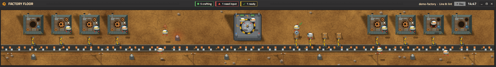
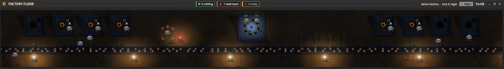

# Factory Floor

A factory-game skin for the [Herdr](https://herdr.dev) desktop app: every coding agent is a
flying robot on a factory floor. Working agents weld at assembling machines, blocked ones wait
by a red alert lamp, finished ones hover over output chests, idle ones charge on the roboport
or patrol. The belt runs, the furnaces burn, and at night the lamps light up the floor.



At night the lamps, furnaces and roboport light up the floor:



All art is original, drawn by `tools/bake_art.py`; no game files are used or downloaded.
Inspired by Factorio; not affiliated with Wube Software.

## Install

```sh
tools/install.sh                                   # copies the layout, theme and mod into ~/.config/herdr-app
herdr-app do layout.switch '{"name":"Factory"}'
```

Then merge `keys.json` into `~/.config/herdr-app/keys.json`: ctrl-shift-j toggles the floor,
ctrl-shift-b the left column, ctrl-shift-g cycles the sky (auto / night / day).

## Try it without agents

```sh
tools/demo.sh        # a "demo-factory" space with stand-in agents in every status
tools/demo.sh stop
```

## Change the art

Edit `tools/bake_art.py`, then:

```sh
nix-shell -p 'python3.withPackages(p:[p.pillow p.numpy])' --run 'python3 tools/bake_art.py'
tools/install.sh
```

(Any Python 3 with Pillow and numpy works.) `RECIPE.md` describes the whole layout for a
rebuild from scratch.

## Also here

`config.toml` is a matching colour theme for the herdr terminal UI (`~/.config/herdr/config.toml`).

Code and art under the MIT License (`LICENSE`); Titillium Web under the SIL Open Font License (`mods/factory/fonts/OFL.txt`).
