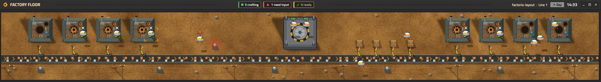

# Factory Floor

An industrial-game skin for the Herdr app. A charcoal title bar with status counters on top,
factories (spaces) and assembly lines (tabs) in sunken panels on the left, the terminals in the
middle, and below them a factory floor in the style of a pre-rendered top-down factory game:
warm cracked desert dirt, assembling machines, a running conveyor belt, furnaces, a roboport,
and every agent is a white flying robot that goes where its status sends it. At night the
floor goes dark blue and the lamps light warm pools.

## What you see

- **Title bar** (40 px, `#313031` with a 1 px `#4a494a` top-left bevel and `#1b1a1b` outline;
  window drag). A gear glyph in `#ff9f1c` (spins while anything crafts), "FACTORY FLOOR" in
  Titillium Web Bold 18 `#ffe6c0`, striped drag fillers, three counters (26 px, `#242324`,
  4 px left border in the status colour): crafting (green square), need input (red alert
  triangle; click: focus the next blocked robot), ready (green tick). On the right the shown
  factory and line, a sky button (light grey game button: `☀ Day` / `☾ Night` / `Auto`), the
  clock `HH:MM`, and window buttons where `window().buttons`.
- **Left column** (290 px, 220–420). "Factories" heading, "+ Line" (`tab.new`) and
  "+ Factory" (`space.new`) light grey buttons (`#8e8e8e`, black text, orange `#ff9f1c` on
  hover). One sunken panel per space: its name (orange when shown), branch, and one 30 px row
  per tab: a status square, "Line n: name", up to four 24 px robot icons; the shown line is
  `#4a3a1f` with an orange border. At the bottom, a 286 px entity card of the focused terminal:
  bot name, a status dot and word, the 104 px robot hovering on a checkered preview
  (`#2b2a2b` / `#333233`, 32 px squares), a progress bar (`▰▱` frames, green) while crafting,
  an inventory slot (40 px, `#1f1e1f`) with a gear item and the agent's turn count, the
  program, folder · title, and a green "Go" button.
- **Terminals** (`#3f3e3f` block, padding 4). Panes framed 2 px `#1b1a1b`, `#ff9f1c` when
  focused, a 30 px header per pane: 3 px left strip (orange when focused), the robot icon, its
  name, program, a status lamp pill, folder and branch, and dark 22 px tool buttons (split
  right, split down, zoom, close) with SVG glyphs.
- **Factory floor** (260 px, 140–260). `floor.png`, 2560×256, centred. Left to right: two
  stone furnaces, four assembling machines (96 px, slate housing, copper deck, two gear wells),
  an inserter under each, the alert lamp, the roboport (128 px, hazard ring), four wooden output
  chests with inserters, four more assemblers, two furnaces. A belt runs the full width at
  y 160–192, wooden power poles with copper wire and six street lamps below it.
- **Robot colours** by program: Claude orange, Codex teal, Gemini blue, OpenCode green,
  pi/omp purple, other agents yellow, plain shells grey (white body, coloured band).
- **Theme** `themes/Factory.json`: terminal `#1e1d1e`, text `#e8e2d6`, accent `#ff9f1c`,
  working `#5eb663`, blocked `#fe5a5a`, done `#ffcc33`, idle `#8e8e8e`.
  Fonts: JetBrains Mono for terminals, Titillium Web (bundled, OFL) for the UI.

## How it behaves

| Status | On the floor | Elsewhere |
|---|---|---|
| working | hovers at an assembler: two copper gears spin in its wells (2400 ms and 1100 ms per turn), its light blinks green, welding sparks flicker | green square / "Crafting", progress bar |
| blocked | waits by the alert lamp under a blinking red triangle; the lamp throws a pulsing red glow | red blinking square / "Needs input!"; bar counter jumps to it |
| done | hovers over an output chest holding a gear wheel, with a blinking tick | yellow / "Output ready" |
| idle | charges on the roboport (battery icon), patrols the walkway, or inspects a quiet assembler; flies there in a straight line (0.12 px/ms) | grey / "Idle" |

- Robots bob (loop on `top`) with their shadow on the ground 14 px right and 24 px down.
  Free spots keep 48 px apart and avoid the working, blocked and done robots.
- The belt carries copper plates on the far lane and iron on the near one: `■` text rows
  shifted one character per frame (`frames`, 70 ms), each lane drawn twice (a dark shadow
  1 px down-right) in step. Furnaces always flicker (two glows out of step).
- Night: `darkness()` is 1 from 20:00 to 05:30, ramps over dusk (18–20) and dawn
  (05:30–07:00). `floor-night.png` fades in over the floor with that opacity, lamp lenses glow,
  robots switch to moonlit sprites, gears dim, plates fade. The sky button or
  `factory.sky` (ctrl-shift-g) cycles auto → night → day (shared `factory.sky`).
- Click a robot, a line, a factory name or "Go": `agent.focus {terminal}` for agents,
  `pane.focus {pane}` for shells; `tab.select`, `space.select`. Drag or scroll pans the floor,
  double-click recentres. The focused robot has orange selection corners.
- Keys (`layout:Factory`): ctrl-shift-j floor, ctrl-shift-b left column, ctrl-shift-g sky.

## Built from

- `layouts/Factory.json`: root column (`titlebar: none`, theme `Factory`): `bar` block 40 px
  → `body` row (padding 6, gap 6): `left` block 290 px (`side`) and a `right` column: `main`
  block (`{ "tab": "active" }`, pane header mod `role: pane`, 30 px, `lone: true`) and `floor`
  block 260 px.
- One mod, `mods/factory`, a role per block (`props.role`): `bar.js`, `side.js`, `floor.js`,
  `pane.js`; `kit.js` (robots, crew, sky), `ui.js` (palette, bevelled frames, buttons, lamps),
  `floormap.js` (generated: where everything stands and the art folder).
- `herdr`: `spaces`, `panes`, `terminals` (for `turn`), `focused`, `window`, `props`, `run`,
  `shared`/`setShared`, `nextCommand`. Commands: `tab.select`, `tab.new`, `space.select`,
  `space.new`, `agent.focus`, `pane.focus`, `pane.split`, `pane.zoom`, `pane.close`,
  `window.*`. No network, no `exec`.
- Art: `tools/bake_art.py` (Pillow + numpy) draws everything: no game files are used. Entities
  are drawn at 4× and downscaled with Lanczos; each casts a blurred shadow skewed east. The night
  floor multiplies the day floor by a light map: blue ambient (0.15, 0.18, 0.30) plus radial
  pools from lamps, furnaces and the roboport. Each bake writes a new
  `mods/factory/art/<stamp>/` and points `floormap.js` at it.

## Watch out

- Herdr caches images by path: a rebake into the same folder keeps showing the old art, hence
  the stamped folder. A freshly swapped image can be blank for a few seconds.
- `frames` needs an initial `.child(text)` or nothing draws; `line_height` on the belt rows
  also made them vanish.
- Herdr's `loop` swings there and back, so one-way motion (the belt) uses `frames`; a robot's
  trip uses `transition` on `left`/`top`.
- Agents started inside fish (like `tools/demo.sh`'s stand-ins) show as the shell program, so
  a shell that reports a status is treated as an unnamed agent (yellow).
- `keys.json` values must be strings (`"layout.toggle:floor"`), not objects.
- 8 working, 5 blocked and 5 done spots; more show a "+n" chip.

## Done when

- `herdr-app check mods/factory` passes and `herdr-app status` lists no errors after
  `layout.switch {"name": "Factory"}`.
- `tools/demo.sh`: four robots weld at assemblers with spinning gears, one waits by the red
  lamp, idle ones charge on the roboport or patrol; the bar reads "n crafting, 1 need input".
- The belt's plates move right; furnaces flicker; the sky button switches to a lit night floor.
- Clicking a robot focuses its terminal and moves the selection corners to it.
